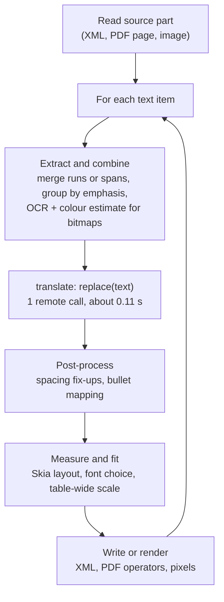
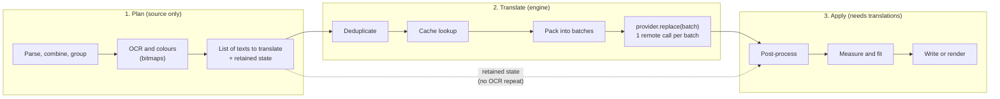
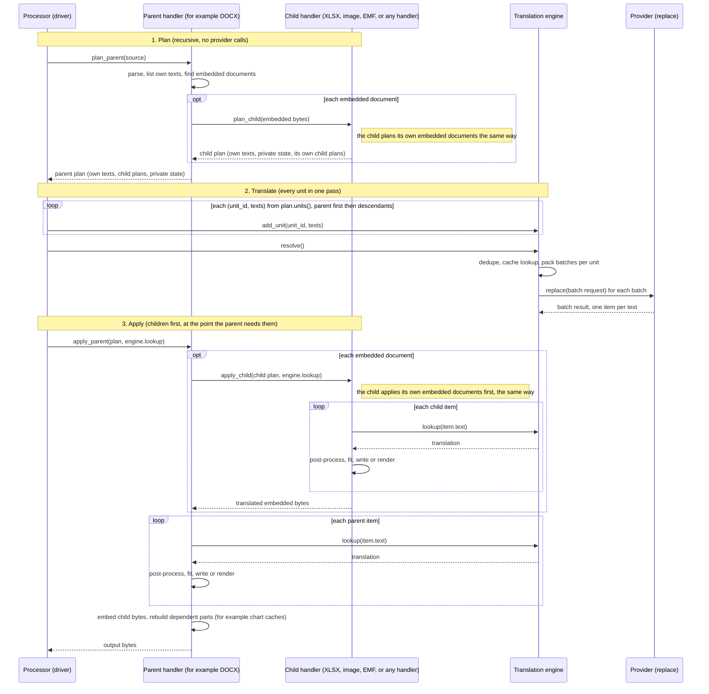
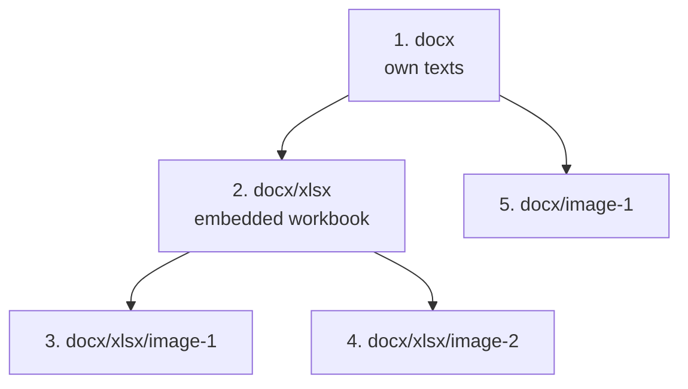
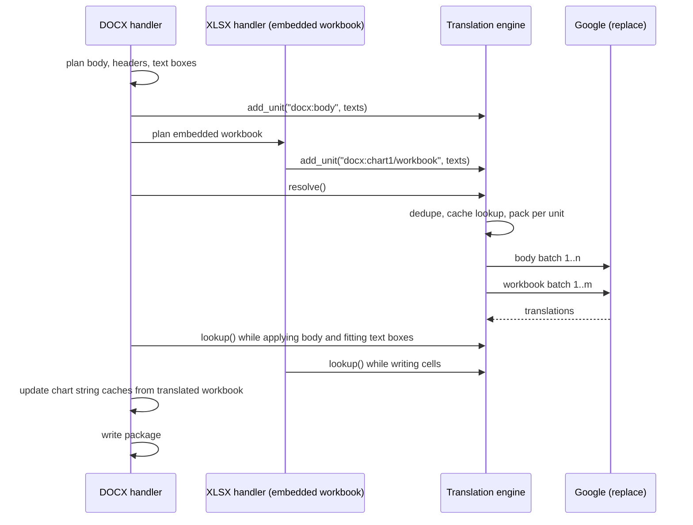
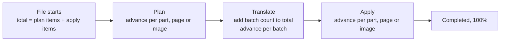

# Batch Text Replacement: Design and Plan

Status: design and plan for batch text replacement. The requirements are `FR-2026-10-22-01` to `FR-2026-10-22-08` and `SR-2026-10-22-01` (section 8), plus `FR-2026-10-22-09` (content-based EMF and WMF identification, added during Phase 5b), plus `FR-2026-10-22-10` (EMF+ text, added during Phase 5c). Phases 0 to 10 are done (vector: SVG, WMF and EMF split; Office package stage and XLSX; DOCX; PPTX plan and apply, then FR-2026-10-22-08 as a separate step; PDF; documentation); Phase 11 (concurrency) is deferred and will not be done.

## 1. Problem

Cache metrics for a large Word document (content-free aggregates from a cache-metrics run):

| Measure | Value |
|---|---|
| Cached `text_replacement` results (`google_cloud_translate`) | 6,901 |
| Input characters | 151,135 (about 22 per string) |
| Total provider time | 769 s (about 12.8 min) |
| Average / min / max per call | 0.112 s / 0.042 s / 10.08 s |
| OCR (`paddleocr`), for contrast | 42 calls, 73 s |

Translation time is dominated by round-trip latency, not content volume. 6,901 sequential calls carrying about 22 characters each cost an average of 0.11 s. The 10.08 s maximum equals the 10-second per-attempt deadline of FR-2026-09-03-04, so it is probably a call that hit that arbitrary deadline and was retried, not evidence that Google is slow on large inputs. Note that `provider_seconds` is wall time per `replace()` call, including retries.

The same 151K characters fit in roughly 31 requests at Google's recommended 5K characters per request, or about 7 at the 1,024-item cap. Measured batched requests (section 1.2) confirm an order-of-magnitude or larger gain: the largest document's estimated translation time falls from about 14 minutes to about 5 seconds.

### 1.1 Other file types (same measurements)

Content-free aggregates from cache-metrics runs, one representative document per type. The "requests at 5K" column is `ceil(characters / 5,000)`, a lower bound that ignores the 1,024-item cap and per-unit splits; it is an estimate, not a measurement.

| Document type | Translate calls | Characters | Avg chars/call | Translate time | Avg / max per call | OCR | Requests at 5K |
|---|---|---|---|---|---|---|---|
| DOCX | 6,901 | 151,135 | 22 | 769 s | 0.112 s / 10.08 s | 42 calls, 73 s | about 31 |
| PDF | 3,404 | 88,189 | 26 | 386 s | 0.113 s / 2.53 s | 108 calls, 33 s | about 18 |
| PPTX | 1,766 | 20,300 | 11 | 211 s | 0.119 s / 3.19 s | 127 calls, 42 s | about 5 |
| XLSX | 219 | 5,724 | 26 | 32 s | 0.145 s / 1.75 s | none | about 2 |

What the numbers show:

- **Every format pays the same per-call cost.** Averages are 0.11–0.15 s per call regardless of type, and strings are tiny (11–26 characters). This is round-trip latency, so batching helps all formats, not only DOCX.
- **Gain scales with string count, not size.** Even the small XLSX (219 calls, 32 s) falls to about 2 requests. PPTX has the shortest strings (11 characters), so it has the highest call count per character.
- **OCR is the cost that remains.** OCR was 8–17% of the old per-document total for DOCX, PDF and PPTX. If translation drops to a few seconds, OCR becomes most of the remaining time. This plan only avoids repeating OCR (section 5.2); speeding OCR up is out of scope. The bitmap plan step (OCR runs there, once) is where OCR parallelism could later be added.
- **Only DOCX shows a timeout-length call.** Its 10.08 s maximum sits at the per-attempt deadline; the others peak at 1.75–3.19 s, so they are ordinary slow calls.
- **Caveat.** Each figure is one document's cache, covering only the runs that populated it. Treat them as examples, not benchmarks.

### 1.2 Phase 0 measurements: batched versus single-text calls

A throwaway script (not committed) translated 1,000 synthetic Japanese strings to English through the real Google provider. The strings are natural UI and report messages averaging 19 characters (longest 56), the same short-string profile as section 1.1. It made 134 requests and 141,558 characters in one pass, with no rate-limit waits. The baseline is 100 single-text calls through the existing provider. Each batched row sends the whole corpus.

| Configuration | Requests | Texts per request | Characters per request | Total | Mean / p95 per request | Texts per second | Speed-up |
|---|---|---|---|---|---|---|---|
| Single text (today) | 100 | 1 | 20 | 11.8 s | 0.12 s / 0.16 s | 8.5 | 1x |
| 100 items | 10 | 100 | 1,937 | 1.3 s | 0.13 s / 0.15 s | 746 | 88x |
| 250 items | 4 | 250 | 4,843 | 0.8 s | 0.19 s / 0.29 s | 1,318 | 156x |
| 500 items | 2 | 500 | 9,686 | 0.4 s | 0.21 s / 0.23 s | 2,347 | 277x |
| 1,024 items (all 1,000) | 1 | 1,000 | 19,372 | 0.4 s | 0.36 s | 2,744 | 324x |
| 2,500 characters | 8 | 125 | 2,422 | 1.3 s | 0.16 s / 0.22 s | 784 | 93x |
| 5,000 characters | 4 | 250 | 4,843 | 0.7 s | 0.17 s / 0.20 s | 1,430 | 169x |
| 10,000 characters | 2 | 500 | 9,686 | 0.4 s | 0.20 s / 0.22 s | 2,503 | 296x |

What the measurements show:

- **The baseline matches production.** A single-text call took 0.12 s on average, against 0.112 s in section 1.
- **Latency is mostly a fixed cost per request.** A fit over all 131 timed requests gives about 0.12 s per request plus about 11 ms per 1,000 characters (correlation 0.71, so approximate). It predicts 0.34 s for the 19,372-character request, which took 0.36 s.
- **Projected times for the measured document profiles.** "Today" extrapolates the 0.12 s single-call average. For Word it gives 816 s against 769 s measured in section 1, within 7%.

| Document | Today (estimated) | 2,500 characters | 5,000 characters | 10,000 characters | 20,000 characters |
|---|---|---|---|---|---|
| DOCX | 816 s | 61 requests, 9 s | 31 requests, 5 s | 16 requests, 4 s | 8 requests, 3 s |
| PDF | 402 s | 36 requests, 5 s | 18 requests, 3 s | 9 requests, 2 s | 5 requests, 2 s |
| PPTX | 209 s | 9 requests, 1 s | 5 requests, 1 s | 3 requests, 1 s | 2 requests, under 1 s |
| XLSX | 26 s | 3 requests, under 1 s | 2 requests, under 1 s | 1 request, under 1 s | 1 request, under 1 s |

- **Default limits are confirmed, not changed.** Most of the gain arrives by about 5,000 characters. Doubling to 10,000 saves about 1 s on the largest document, and 20,000 about 2 s, while a request's latency rises (0.17 s to 0.36 s) and a failed request repeats more text. 5,000 is also Google's recommendation. The 1,024-item cap is not binding for typical strings: 1,000 strings of 19 characters already make 19K characters. The environment overrides (5.6) remain for tuning on real runs.
- **A text's result does not depend on its batch neighbours or its position.** The same 100 texts translated identically in their original order and in a shuffled order within a batch (100 of 100).
- **Batched wording can differ slightly from single-text wording.** 8 of the 100 texts differed from their single-text translation, in the 100-text batch and again in the 1,000-text batch. The differences were small, for example "Chapter 47 Acquisition of Image Data" against "Chapter 47: Acquisition of Image Data", or "failed to retrieve" against "retrieving ... failed". The meaning was unchanged in all 8. Existing per-text cache entries stay valid, so a partly cached document mixes the two wordings, which is acceptable because each text is stable. The cause (batched decoding or single-call variation) was not established.
- **Not measured:** client thread-safety (concurrency is out of scope), requests near the 30,000-character hard limit (the largest request was about 19K), and repeat runs. One pass from one location means differences between close configurations, such as 5,000 against 10,000 characters, are within noise.

## 2. Google Cloud Translation facts

Sources: the [quotas and limits page](https://docs.cloud.google.com/translate/quotas), the [translate text guide](https://docs.cloud.google.com/translate/docs/translate-text), and `TranslateTextRequest` in the [v3 proto](https://github.com/googleapis/googleapis/blob/master/google/cloud/translate/v3/translation_service.proto).

| Fact | Consequence |
|---|---|
| `translateText` takes `repeated string contents`; the response `translations` has the same length and order. | One request can translate many independent strings. This is the supported batching mechanism and already in use for one-element lists. |
| `contents` holds at most **1,024** items. | Hard item cap per request. |
| Advanced v3: at most **30,000** code points per request; **5,000** recommended, because latency grows with size. | Target 5,000. Never exceed 30,000. |
| Quotas: 6,000 v3 requests/min and 6,000,000 characters/min per project. | Batching cuts request-rate pressure. A 151K-character document is about 2.5% of the character quota. |
| Exceeding a quota returns `403` (`User Rate Limit Exceeded`). | Not currently classified as transient. The plan adds a safe backoff that keeps going (5.6). |
| `Translation.translated_text` "might be excluded" on error. | Verify every item; recover per item. |
| `batchTranslateText` and `translateDocument` are asynchronous or file-based. `batchTranslateText` needs Cloud Storage buckets and a caller-managed long-running operation. | **Not used.** SR-2026-08-24-01 limits the provider to pre-trained `translateText`, role `roles/cloudtranslate.user`, no Google Cloud resource creation, and no new remote persistence. |

Measured in section 1.2: a string's output does not depend on its batch neighbours or position. Not verified: `TranslationServiceClient` is safe to share across threads (needed only for the deferred concurrency phase).

## 3. Current implementation

- **Contract.** `TextReplacementProvider.replace(request) -> result`, one string at a time ([provider.py](../pipeline/text_replacement/provider.py), [models.py](../pipeline/text_replacement/models.py)).
- **Google provider.** [google_cloud_translate](../pipeline/text_replacement_plugins/google_cloud_translate/__init__.py) always sends `contents=[text]`, with a 10 s deadline and at most 3 attempts. The stem and suffix handling for filenames, the empty-result check and the safe failure diagnostics all assume one string.
- **Wrapper chain.** The factory wraps a provider in `CachingTextReplacementProvider` ([provider_cache.py](../pipeline/provider_cache.py)) only when caching is enabled. The processor then adds `MeteredTextReplacementProvider` ([provider_metrics.py](../pipeline/provider_metrics.py)) when debug is enabled, and `ContextualTextReplacementProvider` ([failure_diagnostics.py](../pipeline/folder_replacement/failure_diagnostics.py)). XLSX adds its own wrappers in [xlsx.py](../pipeline/folder_replacement/xlsx.py).
- **Cache.** Per-string key: SHA-256 of provider identity, text, filename flag and languages. Rows are read and written one at a time over one connection per source. FR-2026-08-28-01 states "shall not batch requests".
- **Callers.** Every format calls `replace()` inline during traversal, in the middle of layout decisions:
  - DOCX: `_replace` is used for flowing paragraphs, fields, captions and TOC; chart rich text; and text boxes through `replace_and_fit_text_box`.
  - PPTX, XLSX, PDF (spans, OCR items on vector pages), bitmap OCR regions and SVG/EMF/WMF use `replace_native_text`, `replace_paragraphs` or direct calls.
- **Embedded documents.** Today the only nested package is an XLSX workbook behind a Word chart (`_replace_docx_charts` calls `replace_xlsx_bytes`). It has its own progress row and "fast" translation mode ([git history](#10-git-history-consulted)).
- **Choke point.** Every call funnels through `provider.replace`, which is what makes a minimally invasive design possible.

Because translation is interleaved with traversal, layout and rendering, batching cannot be bolted on at the provider alone. Section 5 explains why and how the design handles it.

## 4. Goals and non-goals

Goals:

1. Cut remote-call count by about 10x or more for large documents, keeping output identical to per-string translation.
2. Keep batches within Google's limits, with an embedded document's strings never mixed into its parent's batches.
3. One `replace` method that takes a batch, and no second method or legacy single-text provider API to maintain. New providers stay easy to write (5.5). This deliberately breaks the current provider API once, up front; the built-in providers, wrappers and test fakes are migrated together.
4. Keep the cache key per text, so existing caches stay valid.
5. Preserve the security boundary (SR-2026-08-24-01, SR-2026-08-27-01): no text in logs or diagnostics, no new Google resources.

Non-goals: `batchTranslateText`, glossaries, the LLM model, changing translation quality or layout algorithms, cross-document batching.

## 5. Proposed design

### 5.1 Where translation sits today

Every format handler follows the same shape, and the translation call sits in the middle of it, once per item:



Because each iteration blocks on step D, a document with 6,901 strings makes 6,901 sequential network calls. To batch, the strings of a unit must be known **before** step E runs for the first item.

### 5.2 Why translation is separated from layout

Translated text feeds measuring, fitting and rendering, and none of that work is skipped when the text is unchanged. The call sites show this:

| Handler | What happens after the translation call |
|---|---|
| `replace_and_fit_text_box` ([bounded_text_layout.py](../pipeline/bounded_text_layout.py)) | Always measures and fits, then the caller writes the result. Used by DOCX text boxes, PPTX, XLSX, PDF form fields, SVG and EMF/WMF. Nothing is skipped. |
| PPTX tables | Fitting results feed a table-wide scale. Skipping a fit would change later decisions. |
| PDF content streams | `if replacement == text: continue` skips only the font-encoding step, after the request was already issued. Layout and writing still run. |
| DOCX paragraphs and fields | Replacement text is used only to rebuild runs, so the full rebuild always runs. The one comparison (`span.replacement != span.source_text`) only affects a count. |
| Bitmaps ([bitmap.py](../pipeline/folder_replacement/bitmap.py)) | **OCR and colour estimation happen before translation.** OCR runs once per image and dominates its cost (73 s for 42 images in the Word example above), then the image is rendered. |

The design relies on one property: **the text sent for translation is derived from the source only**. Every branch on a translated result that was found (encoding, bullet mapping, spacing, a render skip for unsupported glyphs) happens after the request is issued, so it can change what is written but not which strings are requested. This needs a per-handler audit (risk table in section 9).

Translation therefore cannot be added by running a handler more than once, because that repeats OCR, fitting and rendering. Each handler is split into a plan function and an apply function instead (5.4), so the expensive source-only work runs once.

### 5.3 Target shape: plan, translate, apply

Split each unit of work into three steps instead of interleaving them:



- **Plan** is everything that depends only on the source: parsing, merging runs and spans, emphasis grouping, OCR, colour estimation, measuring the source. It produces a list of texts to translate and keeps whatever state the apply step needs.
- **Translate** is generic and shared by every format (section 5.7).
- **Apply** is everything that needs the translated text: spacing fix-ups, bullet mapping, measure and fit, writing and rendering. It looks each translation up by its source text.

Cost: the plan step costs parsing and combining but no fitting or rendering, so it is small next to the translation time it removes.

Safety net: apply asks the engine for each translation. A text that the plan did not list is translated by one single-text call and counted in a "plan miss" metric. Because apply looks up the exact texts the plan stored rather than building new ones (5.4), a miss can only come from a deliberately response-dependent text. Output stays correct if a plan under-reports, it is merely slower. Tests require zero misses on synthetic documents.

### 5.4 Plan and apply in each handler, and how they meet the engine

Every handler is split into an explicit plan function and an explicit apply function. Bitmaps follow the same pattern as every other format: their plan step is simply the expensive one, because OCR runs there.

**The contract.** This is a convention each format follows, not a framework or base class:

```python
class Plan(Protocol):
    def units(self) -> Iterable[tuple[str, Sequence[str]]]:
        """Own unit first, then nested units, each as (unit_id, texts in document order)."""

def plan_docx(source: bytes, context: ...) -> DocxPlan: ...                    # source-only work
def apply_docx(plan: DocxPlan, translate: Callable[[str], TextReplacementItem]) -> bytes: ...
```

`translate` is `engine.lookup`, see section 5.7. Handlers never build provider requests: the engine owns the run's language pair and builds the batch requests. Each format has its own plan class holding private state: parsed XML, merged spans, OCR regions and colours, and for every item the exact source text the plan listed.

**Rules:**

1. **Plan** does parsing, merging, grouping, OCR, colour estimation and building the list of texts. It does no fitting, rendering or writing, calls no provider, and has no side effects outside its own plan object.
2. **Apply** does post-processing, measuring, fitting, writing and rendering, in the same order as today. For each item it calls `translate(item.text)` with the text the plan stored. Apply never builds a new text to translate, so plan and apply cannot drift apart.
3. **Nested documents, to any depth.** An embedded document (a chart's workbook, an embedded image, an EMF) has its own handler, plan and apply, and may itself contain embedded documents (a Word document with a workbook that contains images). The parent's plan calls the child's plan, keeps it in its own plan object, and lists the child's units after its own in `units()`. The child's texts therefore join the same plan, resolve and apply cycle as the parent, but as their own unit with their own batches. In apply, the parent calls the child's apply at the point where today's handler calls the nested handler, and embeds the returned bytes (workbook before the chart caches are rebuilt). A handler knows nothing about how deep it is: it only plans and applies its direct children (see "Recursive nesting" below).

   **A nested document uses exactly the same `plan_x` and `apply_x` functions as a root document of that type.** There is no separate nested implementation. A parent calls the child format's public plan and apply entry points, and the only differences are explicit options passed in (for example the Word chart's workbook passes `mode="fast"` and the chart's formula set, as it already does today through `replace_xlsx_bytes`). This keeps behaviour consistent and each format's logic maintained in one place.
4. **Output** is identical to the current interleaved handler. Tests compare against output captured before the refactor.

**How a plan reaches the engine.** A small driver function per source file, in the folder processor, does the wiring. The `opt` blocks are the nested-document steps; a document with no embedded documents skips them:



What is shared between parent and child, and what is not:

| Step | Parent and child |
|---|---|
| Plan | Nested: the parent's plan calls the child's plan, so a child's OCR or parsing runs once, inside the parent's plan step. |
| Units and batches | Separate: each document is its own unit, and a batch never mixes units (5.8). `units()` returns the parent's unit first, then each descendant's. |
| Dedupe | Shared: a text that appears in both is sent once, under whichever unit the engine met first, and both documents read the same result. |
| Resolve | Shared: one `resolve()` for the whole tree, before any apply starts. |
| Apply | Nested: the child is applied inside the parent's apply and returns its bytes to the parent. |
| Progress | Shared: child plan and apply items add to the parent file's bar (5.10). |

**Recursive nesting.** The mechanism is the same at every level, so a Word document with an embedded workbook that contains images needs no extra design:



The numbers are the `units()` order (depth-first, parent before its children). Apply runs where each parent calls its child, so the workbook's two images are applied inside the workbook's apply, and the workbook is applied inside the document's apply.

- **Plans are recursive.** A plan class holds its child plans and flattens them with the same few lines at every level:

  ```python
  def units(self) -> Iterable[tuple[str, Sequence[str]]]:
      yield self.unit_id, self.texts
      for child in self.children:
          yield from child.units()
  ```

- **Unit ids are paths.** A parent gives each child an id below its own (`docx/xlsx/image-1`), so ids are unique across the tree and diagnostics can say which level a unit came from.
- **One engine per top-level source file, for the whole tree.** One `resolve()` covers every level, and dedupe works across levels.
- **The handler contract does not change with depth.** A handler plans and applies its direct children through the same functions the driver uses for top-level files. The driver needs no depth knowledge.
- **One implementation per format, root or nested.** `plan_xlsx`/`apply_xlsx` (and likewise DOCX, PPTX, PDF, bitmap) are the only code that processes that format. A root XLSX file and a workbook embedded in a Word chart go through the same functions, so OCR, merging, fitting, fallbacks and diagnostics cannot drift apart.
  - **Differences are options, not forks.** A small keyword-only options object (for example `mode="fast"`, `chart_formulae`, a progress label) is the only way a parent changes a child's behaviour. Each option is documented on the child's plan function, and a root caller can pass the same option.
  - **Parent-specific work stays in the parent.** Anything that exists only because of the embedding (rebuilding a chart's string cache from the translated workbook, replacing the part in the package) is done by the parent after the child's apply returns, not inside the child.
  - **No `if nested:` branches in a child.** A child never asks whether it is nested. If a behaviour must differ, it becomes an option the parent sets.
  - **Tests enforce it.** A format's tests run through `plan_x`/`apply_x` once. Nested coverage only needs to show that the parent embeds the child's result correctly. A test asserts that a nested document's output equals the output of processing the same bytes as a root file with the same options.
- **Bounded depth.** Embedded documents come from untrusted input, so processing goes at most 6 levels below the root file (the root is level 0, its embedded documents level 1, up to level 6). An embedded document at level 7 or deeper is left unprocessed, exactly as in the source, and the file does not fail. The limit is a hard-coded constant. When `--debug` is set, the source's diagnostic sidecar records one safe `nested_document_depth_limit_exceeded` entry (package part name, depth, never content), so a developer can find it. Ordinary runs write nothing extra. Today only one level exists (a chart's workbook).
- **Tree held in memory.** All plans in the tree, with their retained state (parsed XML, OCR regions, image pixels), exist from plan until apply. For very large trees, a plan can keep only what apply needs, and a unit can be resolved in windows (5.7). Tests must cover three levels, and memory is a tracked risk (section 9).

| Engine call | Made by | Carries |
|---|---|---|
| `add_unit(unit_id, texts)` | Driver, once per unit after planning | The texts that plan items listed, in document order |
| `resolve()` | Driver, once | Nothing; the engine dedupes, answers cache hits, packs and sends batches |
| `lookup(text)` | Handler apply, once per item | The text stored in the plan; returns the translation |

**The same steps in three formats:**

| | DOCX paragraph | PDF page | Bitmap |
|---|---|---|---|
| Plan | Parse the part, merge runs and emphasis groups; one text per paragraph | Merge spans; form-field and vector-OCR texts; one text per merged span | OCR the image, filter regions, estimate colours; one text per region |
| Retained state | XML tree plus item handles (element, text) | Parsed page content plus item handles | Image, regions, colours |
| Apply | Rebuild runs from the translation | Encode, lay out, write operators | Render translated text over the pixels |

**Migration.** Handlers are converted one at a time. A handler not yet converted still translates inline, one text at a time, through a small helper `replace_text(provider, text, ...)` that wraps the text in a one-text batch request (5.5). It behaves as today. A converted handler's old interleaved path is deleted rather than kept beside the new one; the extraction and rebuild code is moved, not duplicated. `replace_text` stays as the single-text helper for the paths that are inherently one text (filenames, and the engine's fallback for a text the plan missed); no handler calls the provider directly.

### 5.5 Provider API: one method, batch in and out

There is a single `replace` method that takes a batch, and no separate single-text method on providers. Every provider always receives a batch, which may contain one text. This is a breaking change to the provider API, made once, up front (Phase 2).

```python
@dataclass(frozen=True, slots=True)
class TextReplacementRequest:
    texts: tuple[str, ...]       # at least one, in document order
    is_filename: bool            # applies to every text in the request
    source_language: str         # BCP 47, as today
    target_language: str

@dataclass(frozen=True, slots=True)
class TextReplacementItem:       # what TextReplacementResult is today, for one text
    text: str
    confidence: float            # 0.0 to 1.0
    extra: dict[str, object] = field(default_factory=dict)

@dataclass(frozen=True, slots=True)
class TextReplacementResult:
    items: tuple[TextReplacementItem, ...]   # same length and order as request.texts

class TextReplacementProvider(Protocol):
    def replace(self, request: TextReplacementRequest) -> TextReplacementResult: ...
```

The request holds `texts` with the language pair and `is_filename` stated once. The engine guarantees one language pair per call (5.7), so a provider needs no grouping code, and a one-text batch is just a tuple of length one.

**Provider rules:**

- The result has exactly one item per text, in the same order. A wrong length is a provider error, detected by the engine and the cache wrapper, with a safe diagnostic that carries counts and never text.
- A failure raises. There are no partial results. A provider that can recover one bad item (as Google does, 5.6) does so internally.
- Providers may expose an optional `batch_limits` attribute. If it is absent, the engine applies no limit. Only providers with a remote size limit need it.

```python
@dataclass(frozen=True, slots=True)
class BatchLimits:
    max_items: int | None = None             # Google default: 1024
    target_characters: int | None = None     # Google default: 5_000 (soft; a single larger text goes alone)
    max_characters: int | None = None        # Google default: 30_000 (hard)
```

**Easy for new providers.** The simplest provider is local and handles one text at a time. A small shared helper in `pipeline/text_replacement/` turns a per-text function into the batch method:

```python
class IdentityProvider:
    def replace(self, request: TextReplacementRequest) -> TextReplacementResult:
        return replace_each(request, lambda text: TextReplacementItem(text, 1.0))
```

`replace_each(request, function)` calls `function(text)` for each text, in order, and builds the result. The identity, the three mask providers and `argos_translate` use it, so they change by a couple of lines each. Only a provider with a real batch API (Google) writes the batch loop itself. The helper is a plain function, not a base class.

**Single-text convenience during migration.** `replace_text(provider, text, *, is_filename, source_language, target_language) -> TextReplacementItem` wraps one text in a one-text request and unwraps the result. Handlers that are not yet converted (5.4) call it where they used to call `provider.replace(request)`. It is not part of the provider API, it is not for new code, and it is deleted when the last handler is converted.

**Wrappers.** `CachingTextReplacementProvider`, `MeteredTextReplacementProvider`, `ContextualTextReplacementProvider` and the XLSX wrappers implement `replace` over batches and forward `batch_limits`. The XLSX wrappers may be removed instead (5.10). The cache wrapper answers hits per text and forwards only the misses to the wrapped provider as one smaller request (5.9).

**Blast radius of the change.** Six provider plugins, six wrapper classes, about 25 test fakes and about 100 call sites change in Phase 2. It is mechanical: nothing behaves differently, because every call is a batch of one until a handler is converted.

### 5.6 Google provider

**Limits.** The Google plugin owns its limits. They are hard-coded defaults (1,024 items, 5,000 target characters, 30,000 hard characters) that environment variables can override, following the existing pattern of `GOOGLE_CLOUD_TRANSLATION_LOCATION`:

| Variable | Default | Valid range |
|---|---|---|
| `GOOGLE_CLOUD_TRANSLATION_BATCH_MAX_ITEMS` | 1024 | 1 to 1024 |
| `GOOGLE_CLOUD_TRANSLATION_BATCH_TARGET_CHARACTERS` | 5000 | 1 up to the hard limit below |
| `GOOGLE_CLOUD_TRANSLATION_BATCH_MAX_CHARACTERS` | 30000 | 1 to 30000 |
| `GOOGLE_CLOUD_TRANSLATION_TIMEOUT_SECONDS` | 300 | 1 to 3600 |
| `GOOGLE_CLOUD_TRANSLATION_RATE_LIMIT_MAX_WAIT_SECONDS` | 1800 | 0 to 86400 (0 disables the backoff) |

- Unset or blank means the default. A non-integer value, or one outside its range, fails when the provider is created, with a safe message naming the variable.
- The limits are read once at provider construction and exposed as the `batch_limits` attribute (5.5). The engine and handlers have no batch configuration of their own.
- They do not affect cache keys, so changing them never invalidates a cache.
- `GOOGLE_CLOUD_TRANSLATION_BATCH_MAX_ITEMS=1` reproduces today's one-text requests, which gives a simple rollback without a code change.
- Tuning is empirical: the `batch_items` metric (5.9) shows the real request sizes after a run, so the target can be adjusted from observed runs.

`replace` does the following with a request of `n` texts:

1. Return empty text and same-language texts unchanged, with no call (the existing shortcut).
2. Apply filename stem extraction and suffix retention per text, as today.
3. Send one `translate_text` request with `contents=[...]` and `mime_type="text/plain"`. Verify the response length equals the text count.
4. Validate each item. A missing or empty translation, or an unsafe filename stem, is recovered by retrying that text alone; only if that also fails does it raise the existing error.
5. On a non-transient failure of a batch of more than one text, bisect the batch to isolate the offending text. On a single text, raise as today. This ensures one bad string cannot fail a document unnecessarily, and costs only `log2(n)` extra calls in a rare case.

**Deadline.** The per-attempt deadline rises from 10 s to a fixed 300 s default, with no scaling by payload, because the pipeline should prefer a translation that passes over one that fails early. The current 10 s value is arbitrary, and slow runs are caused by the number of requests (section 1), not slow individual calls. The deadline still exists so a hung connection cannot block a document forever, and `GOOGLE_CLOUD_TRANSLATION_TIMEOUT_SECONDS` can override it. The three-attempt limit and the transient-error rules of FR-2026-09-03-04 are unchanged, so the worst case before a request fails is three deadlines. Failure diagnostics add the text count and total characters, never text, and still record the per-attempt deadline.

**Quota exhaustion.** This pipeline may later run as part of a larger system with several users translating in parallel, so hitting the project quota must slow a run down, not fail it.
- **Classification.** Google's quota page documents two quota errors, both `403`: `User Rate Limit Exceeded` for a per-minute quota (the 6,000 requests and 6,000,000 characters per minute, per project and per user) and `Daily Limit Exceeded` for a daily quota. Only the per-minute error is treated as a rate limit (together with `429 RESOURCE_EXHAUSTED`). `Daily Limit Exceeded` resets at midnight Pacific time, so waiting a few minutes cannot help. It fails fast with its own safe reason code and a message that says the daily quota is exhausted. A `403` for any other reason (permissions, billing, disabled API) also stays non-transient, so a configuration problem still fails fast.
- **Backoff.** The request is retried after an exponential wait with jitter (starting at 2 s, doubling, capped at 60 s per wait). A server-supplied retry delay is honoured when present. Rate-limit retries do not count against the three-attempt limit, which is for timeouts and transport errors.
- **Keep going.** Retries continue until the request succeeds or the total wait for that request passes `GOOGLE_CLOUD_TRANSLATION_RATE_LIMIT_MAX_WAIT_SECONDS` (default 30 minutes), after which the existing safe error is raised. The limits are per-minute windows, so a wait of up to 60 s normally clears them and 30 minutes is many windows. Google's Translation documentation states the error codes and quotas but does not prescribe a retry policy or a maximum wait, so the cap is our own choice. Results already cached are kept, so a rerun resumes where it stopped.
- **Visible and logged.** Each wait writes a content-free log line (wait number, seconds, text count, never text) and sets the progress label to "Waiting for translation quota". With `--debug`, the failure sidecar records the number of waits and total wait seconds. Metrics add a `rate_limit_waits` count and wait seconds, kept separate from `provider_seconds` so slow API time and quota waiting can be told apart.
- **Tests** use the mocked client and a fake clock, so no test sleeps for real.

### 5.7 Translation engine

New module `pipeline/text_replacement/batching.py`. A handler hands it the plan (texts grouped by *unit*) and later asks for individual translations:

```python
class TranslationEngine:
    def __init__(self, provider: TextReplacementProvider, source_language: str, target_language: str) -> None: ...
    def add_unit(self, unit_id: str, texts: Iterable[str]) -> None: ...
    def resolve(self) -> None:                    # the only step that calls the provider
        ...
    def lookup(self, text: str) -> TextReplacementItem:
        ...                                       # apply step; a miss makes one single-text call
```

One engine exists per source file, matching the existing source cache scope. It owns the run's language pair, so every request it builds has one pair, and `lookup` needs only the text. `resolve()` does the following for each unit in order:

1. Deduplicate on the text and skip texts already resolved by an earlier unit.
2. Pack the rest into batches (5.8) and send each as one `provider.replace(request)`. The cache layer answers hits, so only misses reach Google.
3. Store the items in an in-memory map keyed by text. Nothing is persisted except through the existing cache.

`lookup()` returns the stored item. A text the plan did not contain is translated with a single-text request and counted as a plan miss. Filenames (`is_filename`) are not part of the engine initially; they stay as one-text requests built by their caller.

The driver calls `add_unit` for each unit in a plan (its own and nested ones) after planning, then `resolve()` once; handlers call `lookup` during apply (5.4).

#### Nested documents

An embedded document is processed by its own plan, so its strings form their own unit and are never packed into the parent's batches. All units are resolved together, before any apply step starts. The example is a Word document with a chart whose embedded workbook is translated by `replace_xlsx_bytes`:



The workbook is found by following the chart's relationships, so its plan is made during the parent's plan and its unit is resolved together with the parent's. The apply order is unchanged from today: the workbook is applied first, then the chart's string caches are rebuilt from the translated workbook.

The engine never holds more than text: a 75K-row workbook is a few MB of strings. If first-run metrics show that is too much, a unit can be resolved and discarded in windows without changing the handler contract.

### 5.8 Units and packing

| Unit | Examples |
|---|---|
| Top-level document | DOCX `word/*.xml` parts (one unit, including comments, headers, footers and footnotes); PPTX slides, notes and SmartArt (one unit); XLSX shared strings and cells; one PDF page's native spans; one raster image's OCR items; one SVG/EMF/WMF file. The coverage per format and mode is in 6.2 |
| Nested document | A DOCX chart's embedded workbook; images and vector graphics under any Office `media` folder; images inside an embedded workbook; any future embedded package or OLE document, to any depth up to the nesting limit (own unit, own batches, path-style `unit_id`) |

Packing within a unit:

- Preserve document order. Close a batch at `max_items` or `target_characters`. The engine has one language pair, so no grouping by pair is needed.
- A text larger than `target_characters` goes in its own batch; larger than `max_characters` is rejected with a safe diagnostic, as the API would reject it anyway.
- Batches never span units, which keeps a unit's failure and metrics attributable and avoids long-tail batches that mix documents.
- Deduplicate on the text before packing.

A top-level unit larger than one batch is naturally split into several batches, so documents are never limited to a single request, and per-unit limits only affect packing.

### 5.9 Cache and metrics

- **Cache.** `CachingTextReplacementProvider.replace` looks up each text's key (one transaction per batch rather than a round-trip per text), forwards only the misses to the wrapped provider as one smaller request in the same order, merges the answers back into request order, then writes each item under its existing per-text key. Keys and schema version are unchanged. Existing sidecars remain valid, so a second run with a partial cache sends only the new texts. All hits means no provider call.
- **`provider_seconds`.** For batched rows, store the request time apportioned by character share, and add one nullable column `batch_items INTEGER` (using the existing `ALTER TABLE ... ADD COLUMN` pattern). [cache_metrics.py](../scripts/cache_metrics.py) can then report approximate request count (`SUM(1.0 / batch_items)`) alongside the per-string figures, so averages are not misread as call latency. Content-free, read-only inspection (SR-2026-10-21-01) is unchanged.
- **Run metrics.** `RunMetrics` adds strings requested, unique strings, cache hits, remote requests, plan-miss count, and per-request characters and duration.

### 5.10 Progress

Today there is one bar per source file. Its total comes from `_source_work_total` in [processor.py](../pipeline/folder_replacement/processor.py), which for XLSX counts text requests (`xlsx_native_text_request_total`, advanced through `_NestedXlsxReplacementProvider`). That count is unknown until planning finishes, so it cannot be the unit any more.

Plan, translate and apply each show progress, on the same per-file bar with a phase label:

| Phase | Work item advanced | Total known | Label example |
|---|---|---|---|
| Plan | One per part, slide, sheet block, page or image (the units each handler already counts) | Before the phase starts | Planning page 3 of 40 |
| Translate | One per batch sent | When planning finishes (after dedupe and cache hits) | Translating batch 4 of 31 |
| Apply | The same items as plan | Before the phase starts | Applying page 3 of 40 |



- The total grows once, when the batch count is known. The displayed percentage is clamped so it never moves backwards. A fully cached file has zero batches and the translate phase is skipped.
- Nested documents add their plan and apply items to the parent's total when the parent's plan discovers them, so the parent's bar counts the whole tree. A **large nested document keeps its own extra progress row**, as today, showing that document's plan items, translate batches and apply items. This row is a closer view of work already counted in the parent's bar, not extra work. Because batches never span units (5.8), the engine knows each nested unit's batch count, so the row's translate phase is exact. Small nested documents fold into the parent's bar only. **A nested document gets its own row when it is a bitmap that needs OCR, or when it has more than 100 strings**. Today's workbook row and embedded-image row are the reference behaviour. The 100-string threshold is a hard-coded constant.
- Items weigh equally, so the bar's speed varies by phase (a bitmap's plan step, with OCR, is slower than its apply step). The ETA adapts as it does today.
- Handlers call the existing progress reporter at the same granularity as today, once in plan and once in apply. The engine calls it per batch. The XLSX per-request progress wrappers are therefore replaced by these callbacks, which removes most of their provider-proxy code.
- The `progress.json` shape (`progress`, `eta_seconds`, `files`) is unchanged; only what one unit means changes. This amends FR-2026-08-03-04.

### 5.11 Concurrency (deferred)

Concurrency is not part of this work. Batches in a resolve phase are independent, so they could later run on a small bounded thread pool, with cache writes on one thread (the SQLite session is single-connection). That would depend on the client being thread-safe, which is not verified (section 2). Nothing in the design blocks it, and the quota backoff (5.6) already lets several processes share one project's quota safely.

## 6. Format adoption

Measured examples for DOCX, PDF, PPTX and XLSX are in section 1.1.

Phase exit criteria require output identical to today's, so each plan must cover exactly the text that today's handlers translate in each document-text-layout mode, no more and no less. This section is a coverage inventory built from the current code and the requirements (`word-`, `powerpoint-`, `excel-`, `pdf-`, `vector-requirements.md` and the Office and PDF paragraphs in `general-requirements.md`). Each format conversion starts by re-checking its row against the code and gets a test per listed text class.

### 6.1 The shared Office package stage

DOCX, PPTX and XLSX do not each walk their own package. They first call a shared Office package pass (`_replace_office_file` in [processor.py](../pipeline/folder_replacement/processor.py)), which visits every entry in the zip and does one of three things:

| Entry | Today | In the new design |
|---|---|---|
| Any `.xml` part the format does not claim for itself | Every visible text element (`w:t`, `w:delText`, `a:t`, spreadsheet `t`, HTML `div` and `span`) is replaced one element at a time. This is how comments, headers, footers, footnotes, notes, text boxes and shared strings are covered without format-specific code. | A shared `plan_office_xml` (one text per element, as today) that formats call for the parts they do not claim. |
| `media/*` bitmap | OCR, then replace regions (the bitmap handler) | A nested bitmap plan (section 5.4), identified by the package part name. |
| `media/*` vector (`.emf`, `.svg`, `.wmf`) | Vector handler, which may contain its own embedded bitmaps | A nested vector plan, which may contain nested bitmap plans. |

Which XML parts each format claims, and therefore keeps out of the generic pass:

- **DOCX** claims every `word/*.xml` part (its own paragraph logic), and chart parts.
- **PPTX** in `preserve-source-formatting` lets the generic pass handle every part except SmartArt. In the two fitted modes the generic pass does no XML text at all, and PPTX handles slides, SmartArt and notes itself (below).
- **XLSX** claims shared strings, worksheets, drawings and tables. Other parts, such as comments and chart text, go through the generic pass.

This is why the shared stage is converted before DOCX (Phase 6, with XLSX): each format then reuses it, and media nesting is written once.

### 6.2 Coverage by format

**DOCX** (all modes)

| Text class | Plan produces |
|---|---|
| Body, headers, footers, footnotes, endnotes, **comments** | One text per flowing paragraph after run merging and emphasis grouping. All are `word/*.xml` parts and go through the same paragraph logic. |
| Text boxes | One bounded text box, fitted in the fitted modes. |
| Table of contents paragraphs | TOC result text, with page-number fields left alone. |
| Field paragraphs, captions, cross-references | Field-aware texts. Counters are not translation content. |
| Remaining runs | Leftover `w:t` and `w:delText` runs (including tracked deletions) not handled above. |
| Chart text | Rich text in chart titles, axis titles, custom data labels and chart user shapes. |
| Embedded chart workbook | Nested XLSX plan in `fast` mode. Apply then rebuilds the chart string caches. |
| Images and vector graphics under `word/media` | Nested bitmap and vector plans (6.1). |

**PPTX** (differs by mode)

| Text class | `preserve-source-formatting` | Fitted modes (`preserve-basic-layout`, `…-source-font`) |
|---|---|---|
| Slide text, placeholders, grouped shapes, WordArt | Generic pass, one text per `a:t` element | python-pptx text frames, fitted as bounded boxes |
| Table cells | Generic pass | Fitted with a table-wide scale (stays in apply) |
| SmartArt | Canonical data parts, replaced once per logical value, with the English run-joiner fix-up | Same |
| **Speaker notes** (`ppt/notesSlides`) | Generic pass | Direct text replacement, never fitted (FR-2026-08-04-13) |
| Layouts, masters, chart text, comments, other `.xml` parts | Generic pass | Always translated (FR-2026-10-22-08) through the source-formatting (generic) route, because there is no bounded frame to fit. Added after the refactor (Phase 8, step 2) so the output change is separate |
| Images and vector graphics under `media` | Nested plans | Nested plans |

There is no nested embedded document in PPTX today other than media. A PPTX chart's text is ordinary XML.

**General rule for fitted modes.** A fitted mode fits the text it can fit (slide text frames, table cells) and uses the `preserve-source-formatting` route for every other piece of translatable text, so no text class is silently left in the source language. This is the rule the SmartArt requirement already states (FR-2026-08-04-11: use `preserve-source-formatting` replacement when a text container cannot be fitted). DOCX and XLSX already follow it, so only PPTX needs the change.

**XLSX** (`full` default for standalone files, `fast` for a Word chart's workbook)

| Text class | `full` | `fast` |
|---|---|---|
| Shared strings and cell text | All eligible text cells | Chart-referenced cells and heading rows, plus every cell in worksheets of 1,000 rows or fewer (FR-2026-09-03-06, FR-2026-09-04-01) |
| Numeric-looking text | Excluded | Excluded |
| Table headers | Excluded until FR-2026-08-04-08 is implemented | Excluded |
| Table body cells | Translated | Translated if selected |
| Drawing text (text boxes) | Translated, fitted where bounded | Translated |
| **Comments** | Generic pass | Translated |
| Chart text | Generic pass | Translated, with chart string caches synchronised |
| Large worksheets | n/a | Skipped with a diagnostic |
| Images and vector graphics under `media` | Nested plans | Nested plans (OCR) |

Fast mode's selection runs in plan, and its large-worksheet skip diagnostics are written to the enclosing source's sidecar.

**PDF**

| Text class | Plan produces |
|---|---|
| Native page text | Inferred visual regions and merged spans with their fit state |
| FreeText annotations and AcroForm text fields | One text per value, with appearance streams written in apply |
| Undecodable native text | OCR fallback texts |
| Outlined vector text | OCR texts, per page |
| Raster image XObjects, including those inside Form XObjects | Nested bitmap plans |
| `/ActualText` labels | Not translated. Removed in apply when the visible text is replaced (FR-2026-08-28-04) |

**Bitmap**: OCR regions above the confidence threshold, filtered, with colour estimates; one text per region.

**SVG, EMF and WMF**: editable text, plus embedded raster images (SVG raster images, EMF and WMF DIBs) as nested bitmap plans. Each format is split into an analysis step (lists its texts and images, no replacement) and an apply step (writes the translated texts and applied image plans), behind the shared `VectorDocument` protocol. Fitted layout modes request the paragraph's joined text from the engine, so analysis lists exactly the texts apply will ask for.

**Not translated today**: no code translates document properties, sheet names or defined names, so the plans do not include them. Filenames (`is_filename`) stay one-text requests outside the engine.

**Fitted-mode PPTX (FR-2026-10-22-08):** layouts, masters, chart text and comments are translated through the source-formatting route. Because that changes output, it is done as a separate step after the behaviour-preserving refactor (Phase 8), so the byte-identical comparison stays valid. The same check ("does the fitted mode leave any translatable text class behind?") is repeated for every other format during its own phase.

## 7. Plan

| Phase | Work | Exit criteria |
|---|---|---|
| 0 | **Done.** A throwaway script (not committed) with synthetic Japanese strings measured single and batched `translateText` calls and the independence of results (section 1.2). | Defaults confirmed at 1,024 items, 5,000 target characters and 30,000 hard characters. Batch results are independent of neighbours and order, and differ slightly in wording from single-text results in 8 of 100 strings. |
| 1 | **Requirements** (section 8), written with status `Proposed`. | Requirements reviewed. Each is marked `Implemented` as its phase lands. |
| 2 | **Done** (provider API and Google batching; FR-2026-10-22-02 was `Implemented` here, and FR-2026-10-22-01, -03, -06 and SR-2026-10-22-01 became `Implemented` in Phase 10 once the progress label, the engine metrics and the documentation had landed). **Provider API change, done once.** New request, item and result models, the single batch `replace` on the protocol, `replace_each` and the temporary `replace_text` helper. Migrate the six provider plugins and six wrapper classes, about 25 test fakes and about 100 call sites to it (every call a batch of one, so behaviour is unchanged). Google `replace` sends real batches, with bisect, per-text recovery and environment-overridable limits; the cache does per-text lookup and write, with `batch_items`; metrics. | Existing tests green after the mechanical migration; unit tests with a mocked Google client (no live calls); batching exercised end to end with the identity provider and the recording wrapper; per-text cache compatibility test (old sidecars still hit); environment validation tests; rate-limit tests (quota responses back off and continue, other `403`s, including the daily-limit error, fail fast, the total-wait cap raises the safe error) using the mocked client and a fake clock. |
| 3 | **Done** (the engine, convention, driver and progress hooks; requirements FR-2026-10-22-04, -05 and -07 stay `Proposed` until the handlers convert, because they describe the behaviour of every format). Engine `batching.py` (units, packing, `resolve`, `lookup`, plan-miss metric), the plan and apply convention (`planning.py`: `units()`, path-style unit ids, `enter_nested` depth limit of 6, `PhaseProgress`, `plan_and_apply`), a read-only `cached_flags` presence check so the translate step counts only batches that need a remote request, a rate-limit wait listener for the "Waiting for translation quota" label, and unique-text and plan-miss run metrics. | Property tests run on the identity provider with the recording wrapper (no Google): limits obeyed, order preserved, nested units never share a batch; three-level nesting (document, workbook, image) gives path-style unit ids, depth-first order and one shared resolve; depth limit of 6 enforced (a level-7 document is left unchanged, with a `--debug` sidecar entry only); a nested document gives the same output as the same bytes processed as a root file with the same options; progress totals and clamping tested. |
| 4 | **Done.** **Bitmap** plan and apply (the leaf of every nesting tree): OCR once, in plan; one text per region. `replace_image`, `replace_bitmap_bytes` and `replace_bitmap_file` are now thin compositions of plan, a one-image engine and apply, so every existing caller (Office media, PDF images, XLSX) batches per image until its handler gets a per-source engine. A standalone bitmap runs through the per-source engine and driver with a work total of 2 plus the remote batches. | Output identical to pre-refactor output with the identity and mask providers; OCR runs once per image; request count matches packing. |
| 5a | **Done.** **Vector** plan and apply (`folder_replacement/vector.py`) and the **SVG** handler split into `analyse_svg` (texts, fitted clipped texts and embedded images, one parse) and `SvgDocument.apply`, behind the `VectorDocument` protocol in `vector_text/common.py`. Embedded raster images are nested bitmap plans (the first real parent and child), planned once while `enter_nested` allows the depth; a graphic's unit id is `vector` (or the parent path) and each image is `<parent>/image-<n>`. Apply passes the image analysis already decoded, so each image is decoded once. `replace_vector_bytes` composes plan, a one-graphic engine and apply for Office media; a standalone vector runs through the per-source engine and driver with a work total of 2 plus the remote batches. EMF and WMF are temporarily served by an adapter (`_ReplayedDocument`) that records texts from one run of the old replacer and replays it in apply, so they still pay the double-run cost until 5b and 5c (both since removed). | SVG output byte-identical to the pre-refactor output in all three layout modes (checked by a one-off differential run over synthetic files and by fixed expected bytes in a test); zero plan misses; OCR runs once per embedded image; request count matches packing across text and image units; path-style unit ids for a root vector and one nested under a parent; a nested image equals the same bytes processed as a root file; the depth limit leaves images unchanged with no OCR call and a `--debug`-only sidecar entry. |
| 5b | **Done.** **WMF** split into `analyse_wmf` (texts, the font-handle state, clipped `ExtTextOut` fit contexts and `StretchDIB` images, one parse) and `WmfDocument.apply`, replacing the adapter for `.wmf`; the old one-pass code is deleted from `replacer.py`. The dispatcher now identifies EMF and WMF by **content** (FR-2026-10-22-09), which fixes a defect: EMF graphics saved with a `.wmf` extension failed with "Invalid WMF header size."; they now run through the EMF handler and keep their name. | WMF output byte-identical to pre-refactor output (one-off differential run over 32 synthetic file, layout and replacement combinations including error messages, and fixed expected bytes in a test); zero plan misses for a clipped, font-selected text in all three layout modes; fitted output equals the interleaved path; DIB images decoded once; content-sniffing tests for an EMF named `.wmf`, a WMF named `.emf`, a placeable WMF and the extension fallback. |
| 5c | **Done.** **EMF** split into `analyse_emf` (GDI text candidates, merge groups, fit contexts, EMF+ text records, `StretchDIBits` images, one parse) and `EmfDocument.apply`; `replace_emf` is a thin wrapper. The adapter (`_ReplayedDocument`) is removed. EMF+ parsing and byte-building live in `emfplus.py`. EMF+ `DrawString` and `DrawDriverString` text is now translated together with the GDI text (FR-2026-10-22-10), so dual EMF files keep their EMF+ stream. Fitted modes reuse the GDI fitting through a new EMF+ font object (first free id, cached per font and scale, never modifying the source font). Cases that cannot be translated safely stay unchanged with an `unsupported` or `layout_fallback` sidecar entry. Also fixes the EMF+ placement defect: scaled GDI font records are inserted after the EMF+ header comment, not before it. | Existing EMF assertions unchanged and passing; 17 synthetic tests in `test_vector_emfplus.py` (direct and regenerated positions, unsupported and fallback cases, font object allocation and reuse, malformed comment, lazy image decoding, GDI font placement after the EMF+ header); zero plan misses (planned texts equal requested texts); the adapter is gone; full suite passes. |
| 6 | **Done.** **Shared Office package stage** (`office_package.py`: generic XML text through `office_xml_texts`, and `media` bitmaps and vectors as nested plans with ids `<parent>/image-<n>` and `<parent>/vector-<n>`) and **XLSX** plan and apply (`plan_xlsx`, `apply_xlsx`), `full` and `fast`. Fast mode, the child that DOCX needs later, plans bitmaps only and is tested as a root file. A workbook has one text unit, so all its text is translated in one batch together with its media. The obsolete XLSX progress proxies and request-count helpers are removed; the nested DOCX chart-workbook row now counts plan and apply work items (two per item, translate batches excluded). FR-2026-10-22-04, -05 and -07 stay `Proposed` until DOCX and PPTX convert. | Output byte-identical to pre-refactor output in all six mode and layout combinations (one-off differential run over a synthetic workbook with cells, comments, a drawing text box, chart text and an image); the workbook now needs 1 request where it needed 10 to 14; zero plan misses; output equals an unbatched run; `test_xlsx_plan.py` has a test per text class, nested bitmap and vector units, a nested workbook planning the same texts as a root one, and plan and apply work-item totals. |
| 7 | **Done.** **DOCX** plan and apply (`plan_docx`, `apply_docx`) on top of Phases 4 to 6. Plan and apply share the grouping code in `_replace_docx_xml`, which lists texts when called in list-only mode and so does no fitting or writing in the plan step. Generic XML and `word/media` images and vector graphics go through the shared `office_package` stage (a background colour from `w:background` is passed to image OCR). A chart's rich text and user shapes are listed in the plan; its embedded workbook is a nested XLSX `fast` plan with unit id `docx/chart-<n>`, and images inside it are `docx/chart-<n>/image-<m>`. `replace_docx_file` is now a wrapper over plan, a one-file engine and apply. The unused `xlsx_translation_mode` argument is removed (chart workbooks are always `fast`). `WorkTicker` moved to `planning.py` and is shared with XLSX. The audit of `_replace` call sites found no request that depends on an earlier translation (zero plan misses). The DOCX progress total is now `2 * docx_work_item_total` (one plan and one apply item per `.xml` or media part), and each chart workbook shows two nested rows (plan, then apply). Plan-time chart diagnostics are emitted during planning. FR-2026-10-22-04, -05 and -07 became `Implemented` with Phase 9. | Output byte-identical to the pre-refactor output in all three layouts (one-off differential run over synthetic documents with body, header, footer, footnotes, endnotes, comments, a text box, a chart with user shape and workbook, an image, and a workbook image; only zip timestamps of generated font parts differ); zero plan misses; output equals an unbatched run; one request per unit (document, chart workbook, each image); `test_docx_plan.py` covers body, header, footer, footnote, endnote, comment, text-box, chart and chart user-shape text, the three-level unit ids (`docx`, `docx/image-1`, `docx/chart-1`, `docx/chart-1/image-1`) and plan and apply work-item totals; TOC, field, caption and tracked-deletion text stay covered by the existing `test_folder_replacement_docx.py` tests, which pass unchanged through the plan and apply route (the failure-context and progress expectations were updated to the new stage names and totals). |
| 8 | **PPTX** plan and apply, in all three modes (6.2), reusing the shared Office stage, SmartArt and notes handling. Step 1 is behaviour-preserving. Step 2 (a separate change, FR-2026-10-22-08) adds translation of layouts, masters, chart text, comments and other XML parts in the fitted modes through the shared Office stage, taking care that parts already handled by the fitted route (slides, SmartArt, notes) are not translated twice. **Step 1 is done** (`plan_pptx`, `apply_pptx`, `PptxPlan`). Source-formatting mode lists text through the shared `office_xml_texts` and SmartArt through `drawing_diagram_xml_texts`. The fitted modes list slide text frames and table cells by running the same frame and cell code in a list-only mode on a private copy of the presentation (no fitting, no writing), so plan and apply request the same texts; apply still fits each frame and table from the translated text, then translates speaker notes in memory. Media goes through the shared `office_package` stage with a per-slide background colour for OCR, as unit ids `pptx/image-<n>` and `pptx/vector-<n>`. `ListingProvider` moved from `docx.py` to `planning.py` and is shared. `replace_pptx_file` is a wrapper over plan, a one-file engine and apply; `processor.py` now routes DOCX, XLSX and PPTX through one plan and apply branch, and its separate Office media code is deleted. The PPTX progress total is now `2 * pptx_work_item_total` (one plan and one apply item per `.xml` or media part). Because batches request each distinct text once, the two identical `header` cells of the table test are now one request. **Step 2 is done** (FR-2026-10-22-08, `Implemented`): in the fitted modes every `.xml` part except slides, SmartArt and notes (which have their own routes) goes through the generic source-formatting route, so layouts, masters, notes masters, chart text and modern-comment text are translated, and none twice; `test_pptx_plan.py` has a test per class and a no-double-translation test, and two existing PPTX tests were adjusted because masters and layouts are now requested (the presentation default theme's placeholder text). Legacy `p:text` comments are outside the generic route's text elements in every mode, so they are unchanged. | Step 1: output identical to pre-refactor output in all three modes (one-off differential run over a synthetic deck with slide text, a table, a group, SmartArt, speaker notes and an image: every package part byte-identical); zero plan misses; output equals an unbatched run; one request per unit (presentation, image); `test_pptx_plan.py` covers slide, table, group, SmartArt and notes text in all three modes, the unit ids, work-item totals and the unsupported-layout error; the existing `test_folder_replacement_pptx.py` tests pass with one count changed (the dedup above). FR-2026-10-22-04, -05 and -07 are `Implemented` once PDF converts (Phase 9). Step 2: the newly covered text classes (layout, master, chart title, comment) are translated in all three modes, with a test per class and none translated twice. |
| 9 | **Done.** **PDF** plan and apply (`plan_pdf`, `apply_pdf`, `PdfPlan`), page by page, with only the provider calls changed: the old `replace_pdf_file` is deleted and `processor.py` runs `plan_pdf`, the per-source engine and `apply_pdf`. Plan reads the document into a private writer that is discarded and lists texts by running the existing native text, annotation, form field, appearance stream and bounded-text code in a `list_only` mode (no fitting, encoding or writing). Apply re-clones the document and runs the old code unchanged, with the translation looked up from the engine. Units are `pdf/page-<n>` (native text, annotation text and the page's vector-only OCR text), `pdf/form-fields` and one nested bitmap unit `pdf/image-<k>` per unique embedded image. The vector render document is built once from the source state. Vector OCR, and image OCR, run once in plan; plan stores the accepted regions and colours (not images), and apply rebuilds the overlays from them in the old order, so object ids and the diagnostics summary are unchanged. The PDF progress total is now `2 * (pages + 1 + images)`, and the two steps show "Planning page 3 of 40" and "Applying page 3 of 40". `replace_text` is retained as the documented single-text helper, because filenames and the engine's plan-miss fallback still use it. | Output byte-identical to the pre-refactor output in all three layouts with the mask and a lengthening provider (one-off differential run over a synthetic PDF with native text, a form XObject, an annotation, a form field, a vector-only page, a vector rectangle and two images, plus a one-line PDF); OCR runs once per image and vector page; provider calls fall from 9-10 to 2-4 on that document; no direct provider calls in `pdf.py` outside the engine; `test_pdf_plan.py` covers the text classes in every mode, unit ids, work totals, OCR counts and equality with an unbatched run; the existing `test_folder_replacement_pdf.py` tests pass with one count changed (identical texts are one request) and the progress labels updated. **Known quirk (pre-existing, unchanged):** in the fitted modes a form field's generated appearance stream is translated again after its `/V` was replaced, so it is one plan miss and one extra single-text request per such field, exactly as before. It is recorded as the deferred FR-2026-10-23-02 and will not be fixed unless plan misses appear in real documents. The crash on a non-FreeText annotation or form field (pypdf 6.14, `Key must be a PdfObject`) is fixed in Phase 9b. FR-2026-10-22-04, -05 and -07 are now `Implemented`. |
| 9b | **Done.** Fix the pre-existing crash in the dictionary-text route of `pdf.py`: `_replace_pdf_dictionary_text` set a `str` key on a pypdf dictionary, which pypdf 6.14 rejects with `Key must be a PdfObject`, so any PDF with a non-FreeText annotation or an AcroForm text field failed. The key is now a `NameObject`; nothing else changed. The route is the same in all three layout modes (a widget listed on a page is handled by it, not by the bounded fit), and plan and apply both run it, so the crash was in plan as well as apply. It was kept out of Phase 9 so that phase's byte-identical comparison stayed valid. | A PDF with a text-field widget and a non-FreeText annotation completes in all three modes and translates `/Contents`, `/V` and `/T`; zero plan misses and one request in source-formatting mode; `test_pdf_plan.py` covers both and cites FR-2026-08-03-03 and FR-2026-10-22-04. |
| 10 | **Done.** Documentation: `docs/text-replacement-provider-api.md` (the batch request, item and result models, `replace_each`, `replace_text`, `batch_limits`, the per-text cache, a migration note for the breaking change and two worked example providers), `docs/google-cloud-setup.md` (batching, deadline and quota behaviour with all five environment variables and their defaults and ranges) and a pointer in `docs/container-usage.md`. The wording that the batch requirements superseded is folded into the older requirements (FR-2026-08-02-06, FR-2026-08-28-01, FR-2026-09-03-04, FR-2026-08-03-04, FR-2026-09-03-01 and FR-2026-09-04-01), which now state the final behaviour directly. FR-2026-10-22-01, -03, -06 and SR-2026-10-22-01 are `Implemented`. **No `CHANGELOG.md` entry:** the changelog is written at release by a separate process, which draws on the requirements' rationale sections (FR-2026-10-22-01 now says only that the provider API document describes the breaking change). | Docs match implemented behaviour: defaults, ranges and wait schedule were checked against the provider code, and the worked examples were run. |
| 11 | **Deferred.** Bounded concurrency and tuning; revisit only after real batched runs and a client thread-safety check. | Not in scope now, the tranlsation performance is no longer an issue, we won't do this. |
| 12 | **Done.** **Progress file detail.** Add an optional `details` property to each `progress.json` file entry: while processing, the Current row's active-operation label ("Planning page 3 of 40", "Translating batch 4 of 31", "Applying page 3 of 40", "Waiting for translation quota"), removed on completion, and the failure message for a failed file. Add an optional `eta_status` property, `"Calculating"`, beside each `eta_seconds` that is `null`, including when an estimate reverts to unknown; `eta_seconds` keeps its number-or-`null` type. Requirement FR-2026-10-23-02 (`Implemented`). Independent of the handler phases, so it can land at any time. | Tests per the requirement: `details` follows every step label, is absent before the first label and after completion, and holds the failure message for a failed file; `eta_status` appears exactly when `eta_seconds` is `null` with the progress display on; every observed write is valid JSON. |

**Order rationale.** Leaves first, parents later. Phases 4 to 6 build and prove the pieces that DOCX and PPTX nest (images, then vectors, then spreadsheets), so when the Word handler arrives it only calls finished, tested child plans (5.4). PDF is last because its page logic is the largest and riskiest, and it benefits from every earlier lesson. Each handler still lands as its own change, and handlers not yet converted keep working through `replace_text`.

Each phase after Phase 2 is independently shippable: after Phase 3 nothing batches until a handler is converted. Unconverted handlers translate one text at a time through `replace_text`, which is a batch of one for the provider.

**Testing providers.** Development and regression runs never call Google, because it is slow and costs money.
- **Phases 2 and 3** run entirely on the identity provider (and the existing mask providers), plus a small test-only recording wrapper that counts requests and batch sizes and can set small `batch_limits` to force many batches.
- **Google** is tested only through the mocked client (the existing Google provider tests) in Phase 2. The batch loop, bisect and recovery logic do not need the real service.
- **Handler phases (4 to 9)** compare output before and after the refactor using the identity and mask providers, and check request counts and plan misses with the recording wrapper. Identity output does not change text, so the mask provider is what proves translated text lands in the right place.
- **Live Google** appears once, as an acceptance run on a large slow DOCX after Phase 7 (then PPTX and PDF), to confirm the real speed-up and the quota behaviour.

Testing notes: use synthetic documents and mocked Google clients only. Each new test cites the requirement ID it verifies. Run focused tests with `./run.sh scripts/check-all.py` arguments as appropriate; the existing [Google provider tests](../tests/test_google_cloud_translate_text_replacement_provider.py) are the base to extend.

**Follow-up after Phase 8 (tab and container recovery).** Two PPTX decks failed in a local run because a tab (U+0009) has no glyph in any approved Noto face. The failure pre-dates this work. FR-2026-10-23-01 now treats a tab as whitespace measured as four spaces. FR-2026-08-27-09 is implemented for PPTX frames and table cells, DOCX text boxes, XLSX cells and drawing shapes, and clipped SVG, EMF and WMF text: an unsupported container keeps its source text, adds an `unsupported` sidecar entry, and the document continues. PDF is deferred to Phase 9, so FR-2026-08-27-09 stays `Proposed` until then. Unclipped SVG, EMF and WMF text still falls back to unfitted replacement (FR-2026-10-22-12).
## 8. Requirements

The requirements are in `requirements/`, each with status `Implemented` once its phase landed. Existing requirements are kept, and the clauses the new ones superseded (FR-2026-08-02-06, FR-2026-08-28-01, FR-2026-09-03-04, FR-2026-08-03-04, FR-2026-09-03-01 and FR-2026-09-04-01) were rewritten in Phase 10 to state the final behaviour directly.

| Topic | Requirement | File |
|---|---|---|
| Batch provider API | FR-2026-10-22-01 | `text-replacement-requirements.md` |
| Google batching, deadline and quota backoff | FR-2026-10-22-02, FR-2026-10-22-03 | `google-cloud-translation-requirements.md` |
| Plan, translate and apply, and the engine | FR-2026-10-22-04 | `general-requirements.md` |
| Recursive nested documents | FR-2026-10-22-05 | `general-requirements.md` |
| Cache and metrics | FR-2026-10-22-06 | `general-requirements.md` |
| Progress | FR-2026-10-22-07 | `general-requirements.md` |
| Progress file details and ETA state | FR-2026-10-23-02 | `general-requirements.md` |
| PowerPoint text coverage | FR-2026-10-22-08 | `powerpoint-requirements.md` |
| EMF and WMF identified by content | FR-2026-10-22-09 | `vector-requirements.md` |
| EMF+ text translation and valid EMF+ stream | FR-2026-10-22-10 | `vector-requirements.md` |
| Remote-data boundary | SR-2026-10-22-01 | `security-requirements.md` |

No conflict with SR-2026-10-21-01 or other existing requirements was found beyond the superseded statements. The provider API change is deliberately breaking, so any out-of-tree provider must be updated.

## 9. Risks and scope

Risks:

- **Plan and apply drift.** If a handler's texts ever depend on an earlier translation, the plan under-reports. Apply never builds new texts (5.4), so this can only come from a deliberately response-dependent text; the plan-miss fallback keeps output correct (just slower) and the zero-miss tests catch it. Section 5.2 found no counter-example in the call sites checked, but the check was not exhaustive, so each handler's rewrite includes an audit.
- **Refactor risk.** Rewriting every handler as plan and apply touches intricate code, especially DOCX fields and captions, PPTX tables and PDF spans. Mitigations: one handler per phase, byte-identical output tests against output captured before the refactor, and unconverted handlers translating through `replace_text` until their turn.
- **Breaking provider API.** Out-of-tree or mounted plugins that implement the old single-text `replace` stop working. Mitigations: the change is made once and documented (provider API doc with a migration note and worked examples; the release changelog is drafted from the requirements at release time), `replace_each` keeps a migrated provider to a couple of lines, and the factory should fail with a clear message if a provider returns the wrong number of items.
- **Wide mechanical change in Phase 2.** About 25 test fakes and about 100 call sites change at once. It is behaviour-neutral (batches of one) and reviewable as a pure signature change, but it is a large diff, so it should land as its own change before any handler is rewritten.
- **Larger blast radius per request.** A failing batch is bisected; worst case adds `log2(n)` requests.
- **Timeouts.** The deadline is now a generous 300 s (overridable), so a slow batch passes rather than failing early. The cost is that a genuinely hung connection takes up to three deadlines (15 minutes) to fail a request. This is accepted, and the override allows a shorter value.
- **Wording differences from batching.** Batched translations can differ slightly in wording from single-text translations (8 of 100 in the Phase 0 sample, with the same meaning). A cache built before batching keeps its old wording for those texts, so a partly cached document mixes the two. Each text stays stable once cached, and per-text cache keys are unchanged.
- **Memory.** The planned texts and results for a 75K-row workbook are held in memory, and so are all plans in a nested tree, including retained state such as image pixels and OCR regions until apply. This is likely tens of MB for text but could be larger for image-heavy trees; first-run metrics should confirm it.
- **Nested/root drift.** Past special cases (the XLSX "fast" mode behind a chart) can grow into a parallel implementation. The "same functions, options only" rule in 5.4 and the root-equals-nested test in Phase 3 guard against it; any new option needs a reason in review.
- **Untrusted nesting.** Embedded documents come from input files, so unbounded recursion could exhaust time or memory. The 6-level limit bounds depth. There is no total tree size limit, so a very wide tree is bounded only by the input file's own size and the memory risk above.
- **Quota backoff can hide a stuck run.** A run waiting on quota looks slow, not failed. The progress label, log lines and metrics (5.6) make the waiting visible, and the total-wait cap ends a hopeless wait.
- **PPTX behaviour change.** Translating more PPTX parts in fitted modes (FR-2026-10-22-08) changes output and uses extra requests. It is a separate step after the identical-output refactor, so any difference can be attributed.

Scope:

- Every handler is split into explicit plan and apply functions (5.4).
- One `replace` method takes a batch and returns one item per text (5.5).
- Batch limits are hard-coded in the Google provider, with environment-variable overrides (5.6).
- The per-attempt deadline is a fixed 300 s default, and a per-minute quota error backs off for up to 30 minutes in total while a daily quota error fails fast (5.6).
- Progress is one growing bar for plan, translate and apply. A nested bitmap that needs OCR, or a nested document with more than 100 strings, also gets its own row (5.10).
- Nested documents are processed to 6 levels below the root, with no tree size limit (5.4).
- Layouts, masters, chart text and comments are translated in every PPTX mode (6.2, Phase 8 step 2).
- Concurrency is out of scope (5.11, Phase 11).
- Phase 0 (measurement) is done (section 1.2).
- Phases 3 and 4 are done. The engine counts translate progress by batches that need a remote request, using a read-only cache presence check, so a fully cached source shows no translate step.

## 10. Git history consulted

- `bf95ad9` added the cache and run metrics used for the analysis above; it is the base for the metrics changes in 5.9.
- `1656cb6` introduced the XLSX "fast mode" (and the 75K-row embedded workbook case), which defines the nested-unit and large-unit sizing requirements.
- `de6caf6`, `2cfd389` and `1bb8476` (PDF flow, span merging, vector OCR) are why PDF is adopted late; its call sites are the most varied.
