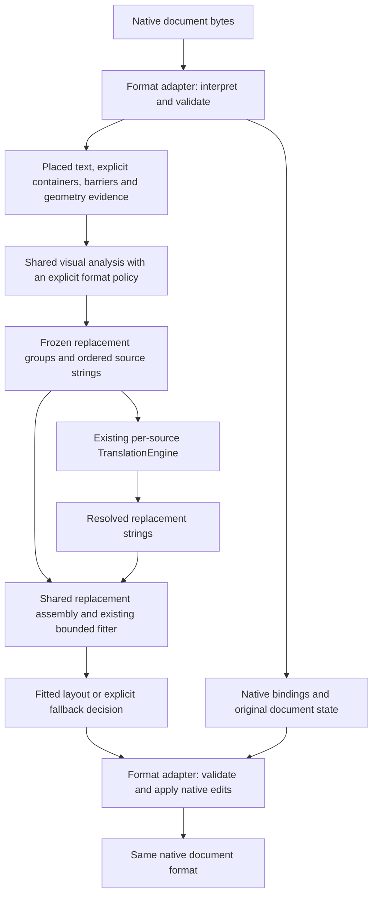
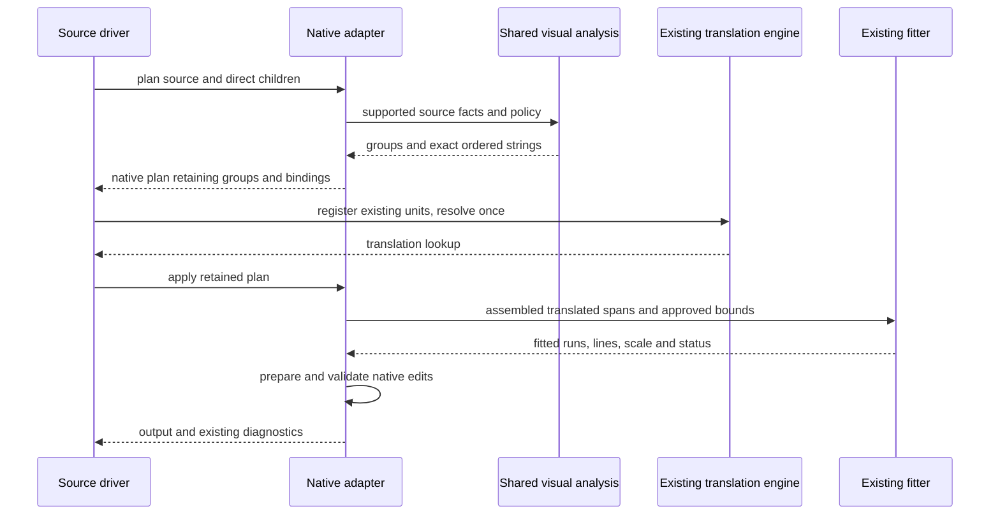

# Shared visual-text layout: design and migration plan

**Status:** Draft Proposal for architectural review; no implementation authorised or started.  
**Date:** 2026-10-29  
**Basis:** `AGENTS.md`, every file in `requirements/`, and inspection of the current layout, PDF, vector, bitmap, translation, and test code. Requirements remain authoritative; this document proposes structure and identifies decisions for review.

## 1. Recommendation

**Yes: extract a small shared visual-text analysis layer and reuse the existing fitting engine.** PDF and EMF already solve sufficiently similar problems to justify sharing placed-text geometry, grouping primitives, translation-span handling, and layout results.

Keep native decoding, graphics-state interpretation, eligibility, and document mutation in each format handler. Those account for much of PDF's difficulty and cannot safely disappear behind a common text rectangle.

Do this incrementally, proving reuse with PDF and ordinary EMF first. Add SVG and WMF as consumers of the common result, initially retaining their current grouping behaviour. Leave bitmap rendering on its existing path until there is evidence that further consolidation pays for itself.

| Approach | Benefit | Cost and risk | Assessment |
|---|---|---|---|
| Keep the current boundaries | Lowest immediate risk; existing fitting and batching already shared | PDF and EMF grouping continue to evolve separately | Reasonable if little more layout work is expected |
| Extract shared analysis above the existing fitter | Reuses the valuable PDF reasoning while retaining native safety | Moderate refactoring and parity work | **Recommended** |
| Convert everything into a complete common scene graph and renderer | Maximum theoretical uniformity | Requires modelling paths, images, clips, compositing, native semantics, and reversible writes | Too large for the likely benefit |

The expected return is easier maintenance and safer extension. Faster processing and better translation are possible later benefits, not demonstrated results of this proposal. The first migration should preserve behaviour.

## 2. What is already shared

This is an extension of the architecture already present, rather than a new pipeline.

| Existing code | Current responsibility | Proposed treatment |
|---|---|---|
| [`bounded_text_layout.py`](../pipeline/bounded_text_layout.py) | Styled paragraphs/runs, source-font resolution, portable fallback segments, wrapping, scale selection, fitted lines | Retain as the fitting authority |
| [`batching.py`](../pipeline/text_replacement/batching.py), [`planning.py`](../pipeline/folder_replacement/planning.py) | Per-source plan/translate/apply, ordered units, deduplication, translation lookup | Retain; add no second translation engine |
| [`vector_text/common.py`](../pipeline/vector_text/common.py) | `VectorDocument`, source-line measurement, single-line fitting helpers | Reuse; extract only genuinely common layout functions |
| [`folder_replacement/vector.py`](../pipeline/folder_replacement/vector.py) | Same vector plan/apply path for standalone and embedded graphics; child bitmap/metafile plans | Retain orchestration and nesting |
| [`folder_replacement/pdf.py`](../pipeline/folder_replacement/pdf.py) | PDF interpretation, visual-flow inference, paint spans, corridor analysis, font encoding, rewriting, OCR overlays | Split analysis from native interpretation and mutation |
| [`vector_text/emf.py`](../pipeline/vector_text/emf.py) | GDI state, affine geometry, coherent single-line groups, expansion, GDI/EMF+ rewriting | Feed shared analysis through an EMF-specific policy |
| [`bitmap.py`](../pipeline/folder_replacement/bitmap.py), [`renderer.py`](../pipeline/text_region_rendering/renderer.py) | OCR regions, colour estimates, polygon fitting, pixel rendering | Retain initially |

`_PdfShownText` and `_PdfVisualRegion` already resemble the proposed input and output of shared analysis. They also carry PDF operation and paint state, which needs to stay in a native side table.

There is a useful planning improvement available too: `PdfPlan` retains strings and OCR plans, while `apply_pdf` reopens the source and reconstructs native regions. Vector documents retain their parsed state. Retaining PDF analysis decisions could avoid repeated inference and reduce plan/apply drift, but needs explicit memory and source-consistency checks.

## 3. The boundary that makes this practical

The common representation describes **text and the evidence constraining its layout**. It does not describe the complete document.



Three responsibilities stay distinct:

1. **Interpretation:** establish what the source means and what can be changed safely.
2. **Analysis and layout:** group supported text, assemble replacement spans, and compute fitting results.
3. **Application:** remove or update source text and serialize the replacement correctly.

For example, a shared result can say that fragments A, B, and C form one line with one output scale. The PDF writer removes their text-showing operations and preserves subsequent text position. The EMF writer writes the line at its anchor, empties successor records, and selects a cloned font. Neither writer needs to imitate the other.

## 4. Proposed in-memory model

Use small typed dataclasses and ordinary functions. Keep the initial API internal. No new dependency, plugin system, persisted interchange format, or generic document base class is needed.

| Value | Essential information |
|---|---|
| `VisualScope` | Local coordinate frame, finite extent when known, policy, text items, barriers/separators, and obstacle-evidence status |
| `TextFragment` | Stable local ID, safely decoded Unicode, source order, origin/baseline/direction, occupied geometry, effective size/style, compatibility keys, and native binding ID |
| `ExplicitContainer` | Existing paragraph/run model and adapter-established bounds; bypasses inferred grouping |
| `BoundaryEvidence` | Explicit non-crossable boundary or separator, its geometry when known, and the operations/scopes it separates |
| `ReplacementGroup` | Ordered member IDs, anchor, fit region, source style choice, translation spans, and permitted layout operations |
| `TranslationSpan` | Exact planned source string, span identity, style/paint identity, and source-boundary information |
| `LayoutDecision` | Group ID, fitted result or fallback outcome, and structured reason/measurements |

The adapter retains a private `binding_id -> native state` table. PDF objects, XML elements, GDI records, font-resource dictionaries, original operands, and document-specific diagnostics stay there. Shared analysis never inspects those objects.

Keep two different identities: a translation span identifies an independently translated string; a layout group identifies text fitted together. Neither is the existing `TextUnit`, which remains a batching and attribution boundary. Equal strings can share a translation while retaining separate placements, styles, and edits.

A native binding may identify a fragment inside an operation, not just the operation itself: one PDF `TJ` array can contribute text to several separate regions. The writer owns aggregation of those edits and restoration of shared position state. Do not assume a one-to-one mapping between fragments, groups, and native records.

Represent source boundaries explicitly as literal whitespace, inferred gap, source soft wrap, or explicit hard break. This permits visual source wraps to supply translation context without forcing output breaks, while retaining provider-returned hard breaks. Keep visual reading order separate from native paint order and the approved insertion anchor.

### Coordinates and evidence

For the eventual shared geometry contract, use floating-point local layout coordinates with a top-left origin and a downward Y axis, compatible with the fitter's 96-DPI layout pixels. These are measurement units, not a rasterized document. An adapter provides the native-to-layout mapping and its inverse where writing needs one.

PDF points, EMF logical/device units, SVG user units, Office EMUs, and image pixels require explicit conversions. EMF units must come from resolved device-context geometry; do not assume a DPI or equate a logical unit with a pixel. Source baselines and advances remain authoritative evidence where the format requires them.

Keep the first extraction in its existing coordinate conventions. Normalize one adapter at a time only after parity is established. Converting geometry and moving algorithms simultaneously would make regressions hard to attribute. Preserve native tolerances, rounding points, reflections, and non-uniform scale during conversion.

An axis-aligned bounding box can conservatively block expansion, but cannot prove that text fits inside a rotated or sheared region. Retain local frames or quadrilateral geometry where needed. Unsupported clipping and unknown geometry remain explicit barriers or unavailable expansion evidence; an empty obstacle list must never mean that the adapter proved the space clear.

Scopes remain independent: no grouping across pages, reusable Form XObjects, separate embedded documents, or the GDI and EMF+ streams of a dual EMF. Reused native objects need object identity separate from invocation placement; retain each handler's existing ownership and deduplication rules.

## 5. Share mechanisms, retain different policies

One universal grouping rule would contradict the existing behaviour. Use a small closed set of policies, implemented by explicit functions with typed inputs. Avoid a growing collection of loosely related boolean switches.

| Input | Initial grouping | Fitting and expansion | Native responsibilities retained |
|---|---|---|---|
| PDF page/Form text | Existing geometry-based lines and evidenced prose blocks; compatible colour spans share a layout | Existing bounded fit and narrowly permitted single-line widening | CMaps, advances, graphics/text state, paint, clipping, `/ActualText`, source removal, encoding and copy/search |
| Ordinary EMF text | Existing constrained contiguous single-line groups | Existing source-bound or verified horizontal expansion rules; transform-specific limits | GDI state, encoding, anchor/successor edits, font handles, record validity |
| EMF+ text | Existing record-level handling | Existing layout rectangle or driver-position extent | Object IDs, glyph-position regeneration, stream ordering, BMP restrictions and chunk validity |
| SVG | Existing clipped containers and eligible leaf text; no new inferred prose | Existing explicit bounds or measured extent; no new expansion | CSS inheritance, text/tail structure, positioning and font embedding |
| WMF | Existing individual records | Existing clip or measured-extent fitting; no new expansion | Selected fonts, legacy encoding, handle lifecycle and record sizing |
| OCR bitmap | Existing provider regions; no new line merging | Existing polygon-contained fit | Confidence, page colour, alpha, wipes, pixel metrics and drawing |
| Office bounded text | Existing native paragraphs/containers | Existing fitter and format-specific bounds/table policy | Theme/style resolution, package structure and serialization |

The reusable PDF mechanisms include projection onto a baseline, line compatibility, separator intersection, local-flow segmentation, gutter evidence, reading order, and grouping results. Extract these without exporting PDF operation semantics. Keep PDF prose classification as the first policy; EMF opts into only the mechanisms its rules permit.

Expansion deserves a separate decision from grouping. A shared corridor/intersection utility can operate on supplied evidence, while each adapter controls which objects are blockers and whether expansion is permitted. PDF's highlight containers and 80% threshold must not become EMF or SVG defaults.

### Translation, typography and paint

Preserve each handler's current translation granularity during extraction. A PDF colour-emphasis group contains independently translated paint spans but one joint fit. An EMF group adopts dominant typography and colour. An ordinary bounded paragraph adopts its dominant run style. Those are separate policies, not interchangeable meanings of a “run”.

Reuse `BoundedTextRun.layout_span_id` to carry span identity through wrapping and portable-font segmentation. Keep paint values in the adapter's table. Never infer which translated word corresponds to a particular source word.

Apply existing joiner and reviewed bullet policies at their current points. Similar-looking Word, SmartArt, and PDF join rules have different conditions; share an implementation only where those conditions actually match.

Source measurement and replacement font selection remain separate. The shared fitter resolves candidate faces, while the adapter establishes whether the selected face can be represented safely in its output. GDI and WMF can remain best effort without portable font embedding; the shared result must not imply otherwise.

Pass output constraints into layout, including single-line/multi-run support, size limits and approved font representation. If translation reveals an encoding or font constraint that changes the selected output face, select a permitted fallback and fit again before writing. Never silently draw with a different face from the one used to fit, except for the existing explicitly required best-effort reference-font cases.

## 6. Lifecycle and native application



Analysis and grouping happen before translation. Source-only measurement is allowed during planning; replacement fitting, rendering, and writing remain in apply. The common analysis layer never receives a real replacement provider. Existing `LookupProvider` bridges can remain while adapters migrate; they must resolve the exact frozen strings.

Some fallback decisions depend on the translated result. An EMF candidate may need individual-record fallback if its returned text cannot be represented as the required line. Model such alternatives explicitly, and list every source string the approved fallback can request during plan. Audit today's fallback requests before changing their ordering or provider workload. Do not split a translated group after resolution and translate newly invented fragments.

Prepare native edits before changing the source representation. Validate that every group member can be rewritten and that required font/encoding resources exist. If any member fails, take the format's approved group/container fallback; do not leave half a replacement group applied. PDF `/ActualText` scopes may require an atomic decision across several groups, so the adapter needs a final scope-wide validation before applying edits.

Use explicit outcomes such as fitted, overflow, direct replacement, retained unsupported, and skipped raster. The adapter maps these to its existing counters, diagnostics, and failure behaviour. A universal “retain on error” rule would be wrong: native overflow, unsupported coverage, unsafe decoding, and raster no-fit have different contracts.

For retained PDF plans, bind analysis to the same source snapshot used by apply. Prefer retaining compact native analysis and an immutable source snapshot or verified source identity, rather than keeping a second complete writer tree and rendered pages alive. Choose this after measuring memory. Never apply operation indexes inferred from different bytes.

## 7. Why bitmap integration should be optional

Bitmaps can supply the common model with OCR text and geometry, but they cannot recover native fonts, source operations, or reliable paragraph structure merely by using that model.

Their fitter currently uses visible glyph bounds, integer pixel sizes, hinting, synthetic emboldening, small-font weight adjustment, polygon containment, and an upright-layout comparison for small skew. The bounded native fitter uses styled paragraphs and a uniform scale. Sharing Skia does not make those algorithms equivalent.

More importantly, native text can remain as translated overflow, while an unfittable bitmap replacement preserves its source pixels and skips both wipe and draw. Every accepted bitmap layout must be decided before the two-pass wipe/draw stage begins.

Initially, share only small geometry utilities where parity is demonstrable. A later bitmap adapter may return the same decision envelope while delegating to the existing raster fitter and renderer. This gives common orchestration without forcing identical rendering.

Moving Vision word grouping out of its provider is also a separate change: its public line regions, background-sampling rules, provider-specific `extra`, and cache identity are already specified. Do not make the shared engine regroup cached OCR output silently.

## 8. Requirements review and decisions before implementation

The proposed separation fits the existing intent of [shared bounded layout](../requirements/general-requirements.md#fr-2026-08-03-14), [cross-format fitting](../requirements/general-requirements.md#fr-2026-08-04-07), [plan/translate/apply](../requirements/general-requirements.md#fr-2026-10-22-04), and [separate native handlers](../requirements/technical-requirements.md#tr-2026-08-03-01).

The review found boundaries that prevent a single unrestricted policy. They do not prevent writing this proposal. The first implementation step is owner review and a focused requirement update, not an implied approval of new behaviour.

| Decision or issue | Treatment for review |
|---|---|
| Should extraction preserve current grouping or introduce richer grouping everywhere? | Recommend behaviour preservation first. SVG prose, EMF multi-line blocks, and cross-line OCR grouping need separate format requirements. |
| Different no-fit and unsupported outcomes | Keep the format exceptions explicit. Common “always translate” behaviour is qualified by decoding, coverage, safety, and raster exceptions. |
| Partial implementation and status metadata | Some vector/core requirements still say `Proposed` although relevant code exists. Record current behaviour with synthetic tests; do not infer completeness from either a status label or a helper's presence. |
| PDF virtual OCR flows | FR-2026-08-29-02 and TR-2026-08-29-02 propose combined native/OCR flows. The inspected plan/apply code keeps OCR regions on a separate overlay route. Treat completion of that feature as separate work, not a hidden part of this extraction. |
| PDF bounded forms and unsupported recovery | Embedded PDF source-font measurement is deferred; shared multi-face/container recovery still has pending PDF scope. Preserve existing limitations rather than claiming this refactor completes them. |
| Translation-dependent fallback strings | Approve the planned-alternative contract and verify exact current requests. The PDF appearance-stream plan miss is separately deferred in the PDF requirements. |
| Requirement ID collisions | Cite file plus ID. For example, FR-2026-09-04-01 occurs in both vector and Excel requirements; FR-2026-10-23-02 occurs in general and PDF requirements. Do not silently rename immutable IDs. |

If approved, put the shared model/analysis contract in `general-requirements.md` and the module boundary in `technical-requirements.md`. Keep format policy changes in their owning files. Update status to `Implemented` only when the corresponding implementation and verification are complete. This proposal changes no requirement statuses.

### Authoritative references for the migration

| Concern | Requirement file and IDs |
|---|---|
| Modes, bounds, source/output fonts, portable segments, tabs and recovery | [General](../requirements/general-requirements.md): FR-2026-08-03-07, FR-2026-08-03-14, FR-2026-08-04-07, FR-2026-08-27-02, FR-2026-08-27-05, FR-2026-08-27-09, FR-2026-10-22-11, FR-2026-10-23-01 |
| Batching, recursive documents, caches and progress | [General](../requirements/general-requirements.md): FR-2026-08-27-10/11, FR-2026-10-22-04 through FR-2026-10-22-07 |
| PDF region inference, paint, semantics, widening and OCR | [PDF](../requirements/pdf-requirements.md): FR-2026-08-23-01 through FR-2026-08-23-06, FR-2026-08-24-01/02, FR-2026-08-28-04, FR-2026-08-29-01/02/03, FR-2026-08-30-05/06, FR-2026-09-01-01 |
| EMF transforms/groups, EMF+, SVG and WMF eligibility | [Vector](../requirements/vector-requirements.md): FR-2026-08-03-05, FR-2026-09-04-01, FR-2026-09-05-01/02, FR-2026-10-22-10, FR-2026-10-22-12/13/14 |
| Raster rendering, grouping, alpha and no-fit | [Raster/OCR](../requirements/raster-ocr-requirements.md): FR-2026-08-02-10, FR-2026-08-03-02, FR-2026-10-24-03, FR-2026-10-26-01, FR-2026-10-27-02/03/04 |
| Office exceptions | [PowerPoint](../requirements/powerpoint-requirements.md): tables, no-autofit and SmartArt; [Word](../requirements/word-requirements.md): flowing text/fields; [Excel](../requirements/excel-requirements.md): structured headers and fast selection |
| Trust boundaries | [Security](../requirements/security-requirements.md): SR-2026-08-03-02, SR-2026-08-24-01, SR-2026-08-27-01, SR-2026-08-29-01, SR-2026-10-22-01, SR-2026-10-24-01 |

Provider, cloud configuration, evaluation UI, container, release, and dependency requirements were also reviewed. This design needs no change to those contracts.

## 9. Incremental implementation plan

Every phase is independently reviewable. A phase that changes behaviour needs its own approved requirement first. Leave later phases unstarted until the earlier result is accepted.

| Phase | Work | Completion gate |
|---|---|---|
| 0. Confirm scope and capture baseline | Review the boundary and policies above; add focused requirements after agreement. Select existing synthetic cases and capture request strings/order, groups, bounds, output and diagnostics. | Approved scope; reproducible baseline with local deterministic providers |
| 1. Isolate PDF analysis | Separate placed-text facts, visual grouping, and native bindings inside the PDF implementation. Keep current units, thresholds, coordinate conventions and writing path. | Same requests, regions, fitting and native semantics; no eligibility expansion |
| 2. Prove a shared layer with EMF | Extract only primitives actually needed by both formats; adapt ordinary EMF grouping with its existing policy. Keep GDI and EMF+ interpretation/writing native. | One implementation of the selected primitives used by both; all existing barriers and fallback outcomes preserved |
| 3. Retain analysis in plans | Freeze groups, spans, binding IDs and approved fallback strings. Address PDF source snapshot and memory strategy. Keep the existing translation engine. | No new plan misses; no replacement-dependent regrouping; no repeated OCR; bounded memory evidence |
| 4. Adopt SVG and WMF | Connect existing containers and single-line helpers to shared results. Reuse `VectorDocument` and keep native serialization. | Existing eligible/ineligible cases and standalone/embedded equivalence preserved |
| 5. Optional bitmap/Office consolidation | Evaluate common geometry and result handling. Keep the raster fitter as a backend; leave Office's existing bounded model and table orchestration intact. | Demonstrated reduction in duplication with unchanged pixels and format-specific behaviour; otherwise stop |

Suggested new location after Phase 2:

```text
pipeline/visual_text/
    models.py       # Text facts, evidence, groups, decisions
    geometry.py     # Only the geometry shared by proven callers
    grouping.py     # Shared primitives and explicit grouping policies
    replacement.py  # Frozen spans to styled replacement input

pipeline/bounded_text_layout.py   # Existing fitting authority
pipeline/folder_replacement/     # Existing orchestration and native handlers
pipeline/vector_text/            # Existing native vector interpretation/writing
pipeline/text_region_rendering/  # Existing raster fitter and renderer
```

Module names are illustrative. Keep PDF-only helpers next to PDF until a second caller justifies extracting them. Initially only the fitted native routes participate; `preserve-source-formatting` and unbounded Word text continue through their existing paths.

### Effort and stop points

These are engineering estimates from code inspection, not measured delivery commitments. They assume one engineer familiar with the code, available synthetic fixtures, and no new format support or rendering dependency.

- **First decision point:** about 2–4 engineering days to isolate a representative PDF analysis path and attempt the EMF mapping. Stop if the model requires native-record inspection in the shared layer or extensive format-specific callbacks.
- **Useful PDF/EMF extraction:** roughly 8–15 engineering days total, including parity work and plan integration.
- **SVG/WMF adoption and broader verification:** roughly another 3–6 engineering days.
- **Bitmap fitting unification:** deliberately unestimated until a separate experiment demonstrates value.

The largest uncertainty is native write validation and regression review, not creating dataclasses. A full common renderer is outside these estimates.

Continue only if a concrete grouping or geometry correction can be made once and verified in both PDF and EMF without weakening either policy. If the shared module becomes mostly dispatch to different implementations, retain the useful small helpers and stop expanding the abstraction.

## 10. Verification and risk controls

Use synthetic documents and repository-owned fonts only. Build on the current PDF, vector, bounded-layout, bitmap, batch-engine and nested-document tests; add tests only for the new boundary or untested invariants. Each new unit test cites its requirement ID as `AGENTS.md` requires.

| Risk | Evidence needed before completing the relevant phase |
|---|---|
| Grouping changes translation context | Compare exact ordered span strings, boundaries and member IDs before/after; include tables, gutters, intervening labels, paint emphasis and list boundaries |
| Native interpretation leaks into common code | Feed equivalent synthetic text facts from PDF and EMF into shared primitives; verify each policy still rejects its unsupported cases |
| Transform/rounding changes | Test non-unit transforms, translated/scaled frames, rotations/reflections/shears where supported, and edge distances around current thresholds |
| Visually correct but semantically wrong PDF | Independently render and extract text; verify replacement order, absence of replaced source text, `/ToUnicode`, `/ActualText`, following text position and reusable forms |
| Invalid vector output | Validate SVG XML, EMF/WMF structure, font handle/object use, suppressed group members, EMF+ header ordering and nested images |
| Planning drift | Record requests and require no new plan misses; explicitly retain the separately deferred PDF appearance-stream exception |
| Fallback changes coverage | Verify native overflow, direct fallback, unsupported retention and raster skip as different outcomes; check no partially applied group or semantic scope |
| Raster regression if Phase 5 proceeds | Pixel equality outside wipes, no wipe for skipped regions, preserved alpha/page colour, same polygon containment and two-pass order |
| Increased memory/work | Compare synthetic multi-page and nested-image workloads; ensure no extra OCR/provider calls and no retained page raster collection |

Use pre-extraction synthetic reference outputs or expectations independent of the moved functions. Comparing two wrappers that both call the same refactored implementation would not establish parity. Compare bytes where deterministic; otherwise compare native structure, text semantics, diagnostics and rendered output with only documented nondeterministic fields excluded.

Run focused tests through `./scripts/run-tests.sh`, and `./run.sh scripts/typecheck-python.py` for every Python change. At completion of an implementation slice, run the complete required suite; use the serial reference runner to investigate ordering differences. Native Word/PowerPoint/Excel review remains necessary where the owning requirements call for it.

### Security and local data

The new model contains source and replacement text and carries the source document's sensitivity. Keep it in memory; do not automatically serialize plans, native bindings, fonts, or geometry dumps. Diagnostics remain the owning adapter's existing, format-specific projection into the source sidecar, rather than a dump of shared objects.

Parsing native documents and fonts remains an untrusted-input boundary. Shared analysis accepts validated facts; it grants no authority to fetch resources. Existing SVG external-reference restrictions, PDFium limits, font provenance rules, cache rules, and recursion depth stay in force. A shared model does not authorise OCR of SVG/EMF/WMF outlines or a new vector renderer.

Only the existing selected provider receives the already authorised text or image payload. Group IDs, native bindings, geometry, metadata, and document bytes do not travel to translation services. This assessment used no confidential samples and made no external service calls.

## 11. Proposed review decision

Approve the **PDF/EMF extraction experiment and requirements refinement** as the first slice. Preserve existing behaviour, retain native writers and the existing fitter/translation engine, and make SVG/WMF adoption conditional on demonstrated reuse. Review bitmap integration separately.

That scope captures the reusable part of the PDF work while keeping the project a straightforward document-processing pipeline.
